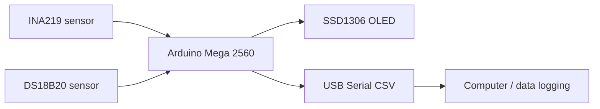

# Smart Battery Health Monitoring ECU

An embedded monitoring prototype that measures battery-side voltage, current and temperature, displays readings on an OLED, and streams measurements over USB serial for logging.

## Project overview

The project demonstrates how a microcontroller can collect electrical and temperature measurements from sensors and present them in a simple monitoring interface.

### Main features

- Voltage, current and power measurement using an INA219 module.
- Temperature measurement using a DS18B20 sensor.
- Local readings on an SSD1306 OLED display.
- CSV-style serial output for recording and later analysis.
- Periodic sensor sampling using a non-blocking `millis()` timing pattern.
- Basic handling of an unavailable temperature reading.

## Hardware used by the starter firmware

| Component | Purpose |
|---|---|
| Arduino Mega 2560 | Main controller |
| INA219 module | Voltage/current/power measurements |
| DS18B20 | Temperature measurement |
| SSD1306 128×64 OLED | Local display |
| USB cable | Programming and serial data |
| Breadboard and jumper wires | Prototype connections |

> The repository firmware currently targets Arduino Mega + INA219 + DS18B20 + SSD1306. Confirm these match your physical prototype before wiring.

## System architecture

See [system architecture](docs/system_architecture.md) for the description and assumptions.

## Repository structure

- `firmware/battery_health_monitor.ino` — Arduino starter firmware.
- `docs/system_architecture.md` — functional block diagram and data flow.
- `docs/pin_connections.md` — proposed pin mapping and wiring checks.
- `docs/libraries.md` — required Arduino libraries and setup.
- `docs/testing_procedure.md` — bench validation procedure.
- `docs/system_design.md` — initial project design notes.
- `docs/testing_and_validation.md` — validation notes and evidence checklist.

## Software setup

1. Install Arduino IDE.
2. Select **Arduino Mega or Mega 2560**.
3. Install Adafruit INA219, OneWire, DallasTemperature, Adafruit GFX and Adafruit SSD1306 libraries.
4. Open `firmware/battery_health_monitor.ino`.
5. Verify I2C addresses, sensor wiring and supply requirements.
6. Compile and upload.
7. Open Serial Monitor at **115200 baud**.

Detailed instructions: [Library and setup guide](docs/libraries.md).

## Serial data

The firmware prints:

`time_ms,voltage_V,current_mA,power_mW,temp_C`

The data can be captured by a serial terminal or a separate logging program.

## Validation status and limitations

The firmware is a starter implementation and has not been represented as hardware-tested. Actual wiring, sensor calibration, measurements, and test results must be added after bench verification.

This version does **not** implement a validated State of Charge (SOC) or State of Health (SOH) algorithm, cell balancing, or battery protection cutoff. Do not claim predictive battery health or measurement accuracy without a defined method and recorded validation.

## Safety

- Verify battery chemistry, voltage and current limits before testing.
- Check the INA219 module's voltage/current ratings and shunt arrangement.
- Use a properly rated fuse and protected, current-limited bench setup.
- Never connect a battery directly to the Arduino power pins.
- This educational prototype is not an automotive-qualified battery management system.

## Author

**Gurubaran G K**  
B.E. Electronics and Communication Engineering
