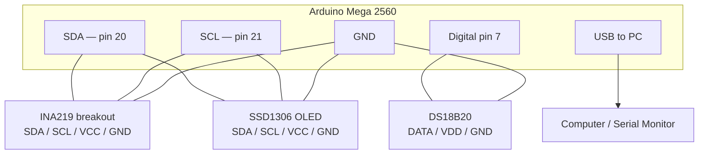

# Proposed Circuit Diagram — Battery Health Monitoring ECU

> This is a wiring reference based on the starter firmware assumptions. It is not a verified as-built schematic. Confirm each breakout board's voltage limits and pin labels before connecting.

## Connection overview

## Wiring table

| Signal | Arduino Mega 2560 |
|---|---|
| INA219 SDA | SDA / pin 20 |
| INA219 SCL | SCL / pin 21 |
| OLED SDA | SDA / pin 20 |
| OLED SCL | SCL / pin 21 |
| DS18B20 DATA | Digital pin 7 |
| Sensor/display grounds | GND |
| Serial monitor | USB |

The DS18B20 may require a 4.7 kΩ pull-up between DATA and its supply. Check the exact sensor assembly.

## Battery measurement path

Follow the INA219 breakout manufacturer's high-side measurement diagram for the battery and load path. Do not infer terminal placement from this logic diagram. Check the module's maximum bus voltage, current rating, shunt rating and polarity. Use a fuse and a current-limited protected test source.

## Important verification checklist

- [ ] Confirm the actual controller is Arduino Mega 2560.
- [ ] Confirm INA219 breakout voltage/current ratings.
- [ ] Confirm OLED I2C address and supply voltage.
- [ ] Confirm DS18B20 pinout and pull-up arrangement.
- [ ] Verify wiring continuity with power disconnected.
- [ ] Test with a safe current-limited bench source before battery use.
