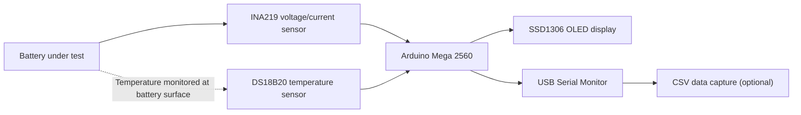

# System Architecture — Smart Battery Health Monitoring ECU

## Functional block diagram

## Data flow

1. INA219 provides bus-voltage and current measurements over I2C.
2. DS18B20 provides temperature readings through the OneWire interface.
3. Arduino Mega samples the sensors periodically.
4. The measured values are shown on the OLED and printed as CSV over USB serial.
5. A computer can save the serial data for later analysis.

## Current implementation scope

The uploaded starter firmware performs sensor reading, display and serial logging. It does not implement a validated battery SOC/SOH algorithm, cell balancing, over-current cutoff, thermal protection, or a certified battery management function.

## Design assumptions

- Controller: Arduino Mega 2560
- Voltage/current sensor: INA219 breakout
- Temperature sensor: DS18B20
- Display: SSD1306 I2C OLED
- Serial output: 115200 baud

Confirm the exact hardware and wiring before treating this diagram as the final as-built architecture.
